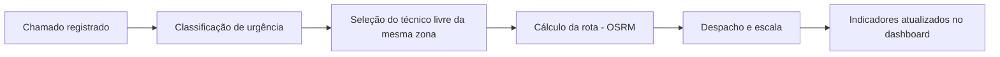
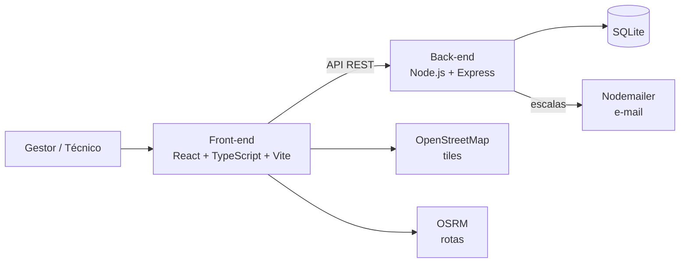

[README_Onfield_final_ok.md](https://github.com/user-attachments/files/34943387/README_Onfield_final_ok.md)
<div align="center">

<picture>
  <source media="(prefers-color-scheme: dark)" srcset="docs/logo-onfield-dark.png">
  
</picture>

<br><br>

**Gestão operacional e roteirização inteligente para técnicos de campo nas Unidades Básicas de Saúde de Manaus.**


[Reportar Bug](https://github.com/Abraaobritto/onfield/issues) · [Solicitar Feature](https://github.com/Abraaobritto/onfield/issues)

</div>

---

## 📑 Sumário

- [Sobre o Projeto](#-sobre-o-projeto)
- [Funcionalidades](#-funcionalidades)
- [Demonstração](#-demonstração)
- [Como Funciona](#-como-funciona)
- [Tecnologias](#️-tecnologias)
- [Começando](#-começando)
- [Como Usar](#-como-usar)
- [API](#-api)
- [Regras de Negócio](#-regras-de-negócio)
- [Estrutura de Pastas](#️-estrutura-de-pastas)
- [Roadmap](#-roadmap)
- [Autores](#-autores)

---

## 📋 Sobre o Projeto

As Unidades Básicas de Saúde (UBSs) dependem de equipes itinerantes de campo para manter redes, computadores e sistemas de atendimento. Sem uma visão geográfica centralizada, a alocação desses técnicos gera **deslocamentos ineficientes, ociosidade da equipe e lentidão no restabelecimento dos serviços**, o que se reflete no tempo de espera dos pacientes.

O **OnField** reúne em uma única plataforma web:

- o mapeamento das **73 Unidades de Saúde da Família (USFs) de Manaus**, divididas por zona;
- a **priorização de chamados** por nível de urgência;
- a **roteirização** entre técnico e unidade;
- a **gestão de escalas**, individuais e em lote;
- um **dashboard analítico** com os principais indicadores da operação.

O projeto é o Trabalho de Conclusão de Curso (TCC) de Sistemas de Informação do Centro Universitário Fametro.

---

## ✨ Funcionalidades

| | Funcionalidade | O que faz |
| :-: | --- | --- |
| 🗺️ | **Mapa operacional** | UBSs e técnicos no mapa (Leaflet + OpenStreetMap), com filtro por zona: Norte, Sul, Leste e Oeste. Os marcadores diferenciam as unidades por porte (I e IV) |
| 🧭 | **Roteirização** | Traça a rota e calcula a distância entre origem e destino com OSRM, e permite consultar técnicos num raio de 1,5 km da unidade |
| 🚨 | **Priorização por urgência** | Cada unidade recebe um nível de prioridade e o chamado pode ser aberto direto pelo card da unidade |
| 📅 | **Escalas** | Escalas regulares e em lote, edição de datas, envio por e-mail (Nodemailer), exportação em PNG e compartilhamento por WhatsApp |
| 📊 | **Painel de Inteligência Executiva** | Taxa de cobertura, técnicos alocados e livres, produtividade por profissional, visitas por zona e exportação do relatório em PDF |
| ♿ | **Acessibilidade (WCAG)** | Mapa combinado com tabelas e listas semânticas para leitores de tela, navegação por teclado e alto contraste |
| 🔒 | **Segurança e LGPD** | Controle de acesso por perfil (RBAC), dados cadastrais restritos ao Gestor e endereços abstraídos em coordenadas no mapa |

---

## 🎬 Demonstração

<table>
  <tr>
    <td width="50%" align="center">
      <br>
      <sub><b>Login</b> com controle de acesso por perfil</sub>
    </td>
    <td width="50%" align="center">
      <br>
      <sub><b>Mapa operacional</b> com as 73 UBSs e os técnicos por zona</sub>
    </td>
  </tr>
  <tr>
    <td width="50%" align="center">
      <br>
      <sub><b>Card da unidade</b>: prioridade, histórico, escala atual e geração de chamado</sub>
    </td>
    <td width="50%" align="center">
      <br>
      <sub><b>Painel gerencial</b>: escala oficial, envio por e-mail, PNG e WhatsApp</sub>
    </td>
  </tr>
  <tr>
    <td colspan="2" align="center">
      <br>
      <sub><b>Painel de Inteligência Executiva</b>: cobertura, produtividade e prioridade dos chamados</sub>
    </td>
  </tr>
</table>

---

## 🔄 Como Funciona

**Fluxo de um chamado**



**Arquitetura**



---

## 🛠️ Tecnologias

**Front-end** (`escala-ubs/`)

- React + TypeScript, com Vite
- Leaflet e React-Leaflet (mapas e marcadores)
- Leaflet Routing Machine + OSRM (rotas e distâncias)
- html2canvas (exportação das escalas em imagem)
- Lucide Icons

**Back-end** (`server/`)

- Node.js + Express (API REST e regras de negócio)
- SQLite (`sqlite3` / `sqlite`)
- Nodemailer (envio de escalas por e-mail)
- CORS

---

## 🚀 Começando

### Pré-requisitos

- [Node.js](https://nodejs.org/) 18 ou superior e npm
- [Git](https://git-scm.com/)
- Conexão com a internet (tiles do OpenStreetMap e rotas do OSRM)

### Instalação

```bash
# 1. Clone o repositório
git clone https://github.com/Abraaobritto/onfield.git
cd onfield
```

```bash
# 2. Terminal 1 - back-end (API + banco SQLite)
cd server
npm install
node index.js
```

```bash
# 3. Terminal 2 - front-end
cd escala-ubs
npm install
npm run dev
```

Acesse **http://localhost:5173** no navegador.

<!-- Se o envio de e-mail (Nodemailer) usar credenciais SMTP, documente aqui as variáveis de ambiente necessárias. -->

---

## 📖 Como Usar

1. **Login:** entre com o perfil de **Gestor (ADMIN)** para acessar o painel completo.
2. **Mapa Operacional:** use os filtros *Todas, Norte, Sul, Leste e Oeste* para ver a distribuição das 73 UBSs e dos 20 técnicos cadastrados.
3. **Priorizar e rotear:** clique em uma unidade para alterar a prioridade, ver o histórico da última visita, consultar a escala atual ou gerar um chamado. No **Roteirizador** (canto superior direito), informe origem e destino e clique em *Traçar Rota*.
4. **Escalas:** em **Relatório de Escalas**, crie escalas em lote, edite datas, gerencie a equipe e exporte em PNG ou compartilhe por WhatsApp.
5. **Indicadores:** em **Analytics (Dashboard)**, filtre por *Hoje, 7 dias, Mês ou Personalizado* e exporte o relatório executivo em PDF.

---

## 🔌 API

| Método | Rota | Descrição |
| :-: | --- | --- |
| `POST` | `/api/login` | Autenticação e validação de perfil (RBAC) |
| `GET` | `/api/ubs` | Lista as UBSs com coordenadas e zona |
| `GET` | `/api/tecnicos` | Lista os técnicos, especialidade e disponibilidade |
| `GET` | `/api/chamados` | Retorna os chamados e seus níveis de urgência |
| `POST` | `/api/chamados` | Registra um novo chamado para uma UBS |
| `GET` | `/api/escalas` | Consulta as escalas regulares programadas |
| `POST` | `/api/escalas/lote` | Cria escalas em lote e dispara notificações por e-mail |

---

## 🧠 Regras de Negócio

| ID | Regra | Descrição |
| :-: | --- | --- |
| RN01 | Alocação por urgência e zona | Chamados urgentes têm prioridade para o técnico disponível da mesma zona geográfica |
| RN02 | Exclusividade de atendimento | Um técnico não pode ser alocado em dois atendimentos simultâneos |
| RN03 | Taxa de cobertura | Relação entre unidades atendidas e o total de UBSs cadastradas |

> **Validação com usuários:** pesquisa quantitativa com **39 profissionais** do setor público de saúde e TI. Dos respondentes, **59,0%** confirmam aumento imediato nas filas de pacientes quando há demora na solução de falhas técnicas e **76,9%** concordam que enviar o técnico geograficamente mais próximo reduziria o tempo de resposta.

---

## 🗂️ Estrutura de Pastas

```text
📦 onfield
├── 📁 server/                 # Back-end (Node.js + Express + SQLite)
│   ├── 📄 index.js            # Rotas da API, regras de negócio e Nodemailer
│   ├── 📄 database.js         # Conexão e criação das tabelas
│   └── 📄 package.json
├── 📁 escala-ubs/             # Front-end (React + TypeScript + Vite)
│   ├── 📁 src/
│   │   ├── 📁 components/     # Mapa, modais, analytics, escalas e roteirizador
│   │   ├── 📄 App.tsx         # Estrutura principal e navegação
│   │   └── 📄 types.ts        # Interfaces TypeScript
│   └── 📄 package.json
├── 📁 docs/                   # Logo do projeto
└── 📄 README.md
```

---

## 🗺️ Roadmap

- [x] Mapa operacional com as 73 UBSs e filtro por zona
- [x] Priorização por urgência e roteirização com OSRM
- [x] Escalas em lote com envio por e-mail, PNG e WhatsApp
- [x] Dashboard analítico com exportação em PDF
- [ ] Teste de usabilidade em campo com a escala **SUS**
- [ ] **PWA** com armazenamento offline (IndexedDB) para áreas sem conectividade
- [ ] Sugestão de despacho em tempo real via GPS do técnico
- [ ] Migração do SQLite para **PostgreSQL** em produção

---

## 📄 Licença

Distribuído sob a licença MIT. Veja o arquivo [LICENSE](LICENSE).

---

## 👨‍💻 Autores

| | Autor | Contato |
| --- | --- | --- |
| 👤 | **Abraão Brito Oliveira** | [GitHub](https://github.com/Abraaobritto) · [LinkedIn](https://www.linkedin.com/in/abraao-brito-7a5730227/) |
| 👤 | **Klisman Matheus Trindade de Oliveira** | [GitHub](https://github.com/klismanmatheus) · [LinkedIn](https://www.linkedin.com/in/KlismanMatheus) |

Trabalho de Conclusão de Curso do curso de Sistemas de Informação, Centro Universitário Fametro.

## 🙏 Agradecimentos

- À orientadora **Profa. Luana Magalhães Leal**, pelo acompanhamento e pela orientação metodológica durante todo o projeto.
- Ao **Centro Universitário Fametro** e ao corpo docente do curso de Sistemas de Informação.
